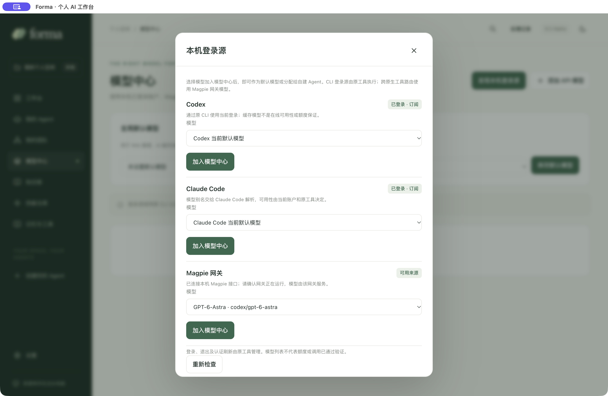
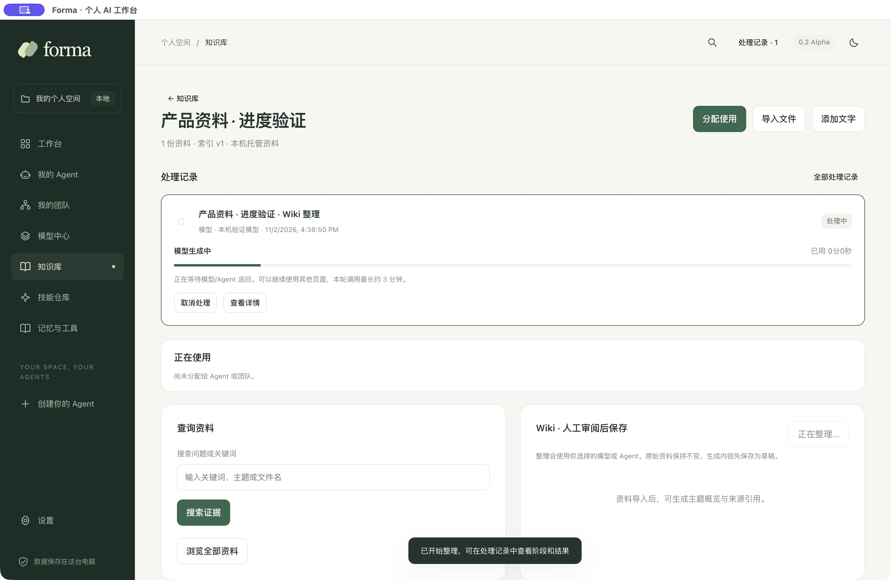
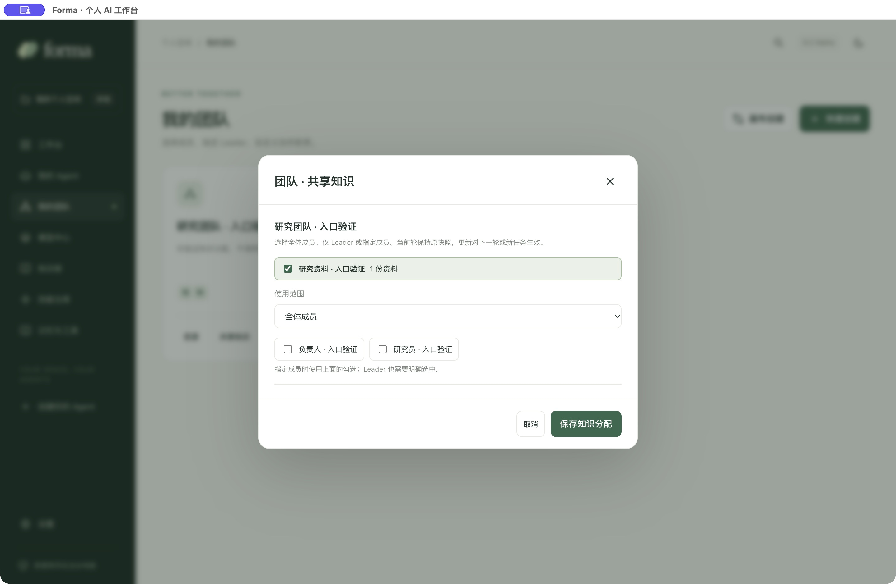
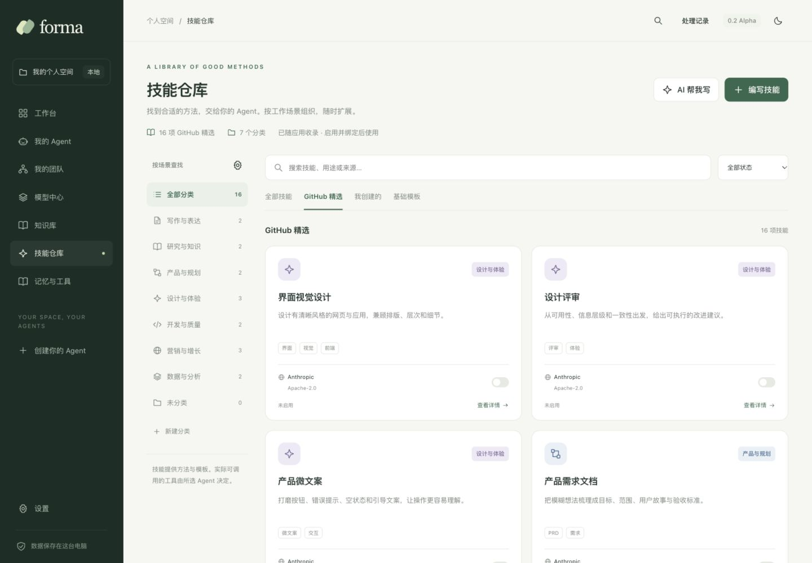

<div align="center">
  
  <h1>Forma</h1>
  <p><strong>你的 Agent，你的团队，一个持续工作的 AI 空间。</strong></p>
  <p>面向个人进阶用户的开源 AI 桌面工作台，让模型、知识和技能围绕任务协作。</p>

[](https://github.com/wpfbcr/forma/actions/workflows/check.yml)
[](https://github.com/wpfbcr/forma/releases)
[](LICENSE)
[](#快速开始)

**简体中文** · [English](README_EN.md)

[项目介绍](#项目介绍) · [快速开始](#快速开始) · [产品导览](#产品导览) · [功能概览](#功能概览) · [文档](#文档) · [参与贡献](#参与贡献)
</div>

## 项目介绍

Forma 将个人创建的 Agent、已安装的 Codex / Claude Code、知识库与技能放进同一个桌面工作台。你定义角色和团队，只与 Team Leader 持续对话；Leader 负责规划、分派、协调和交付。任务的资料、上下文、执行记录与成果保留在本地工作空间，下一轮可以接着做。

适合希望同时处理编程、研究、写作和日常工作的个人用户。首次启动为空白个人空间，按自己的需要选择模型、创建 Agent 和组织团队。

- **自由组合**：自建 Agent 或接入已有工具，按角色选择模型与职责。
- **围绕任务工作**：持续对话与真实文件空间并排，保留过程和成果版本。
- **积累可复用能力**：知识库按使用对象分配，技能可以自己写、让 AI 写或启用预置项。

> [!NOTE]
> 当前为 **0.2.0-alpha.7**，界面主要为简体中文。macOS Apple Silicon 已进行本地桌面验证；Windows 和其他平台的实际情况见 [Actions](https://github.com/wpfbcr/forma/actions) 与[验证记录](docs/validation.md)。安装包未签名、公证；真实模型权益、额度和外部工具兼容性需在你的环境中确认。

## 快速开始

### 方式一：下载桌面应用

前往 **[GitHub Releases](https://github.com/wpfbcr/forma/releases)**，按每个版本列出的系统和架构下载附件。Alpha 版本标记为预发布，不能通过 `/releases/latest` 获取。

| 平台 | 当前说明 |
| --- | --- |
| macOS Apple Silicon | 提供 ZIP 应用包；解压后将 `Forma.app` 放入“应用程序” |
| Windows x64 | 提供 NSIS 安装包；已通过 CI 构建，实机桌面验收尚未完成 |
| Intel Mac / Linux | 暂未承诺安装包或完整桌面支持；可自行源码构建并反馈兼容问题 |

若系统提示无法验证开发者，请先核对下载来源和版本校验值。正式签名和公证尚未完成；不建议关闭系统整体安全保护。

### 方式二：从源码运行

需要 **Node.js 22.12+**（推荐 24 LTS）、npm 与 Git。日常使用不需要 Docker、外部数据库或 Python。

```bash
git clone https://github.com/wpfbcr/forma.git
cd forma
npm ci
npm run dev
```

第一次安装依赖会下载锁定版本的 Electron 运行时。网络或下载异常见[安装与构建](docs/installation.md)。应用通过 Electron 启动，不能直接双击 `src/renderer/index.html` 使用。

### 开始第一项任务

1. 打开**模型中心**，点击“发现本机登录源”，导入已登录的 Codex / Claude Code 模型；或添加 API 服务，填写地址与密钥后获取模型列表。
2. 创建自己的 **Agent**，配置职责、模型、记忆和文件工具；也可以直接接入本机已有 Agent。
3. 创建团队并指定 **Leader**，通过画布或快捷列表配置成员。单个 Agent 也可独立工作。
4. 在**工作台**描述目标，选择 Agent 或团队，开始任务。后续向 Leader 补充要求，右侧查看资料、上下文、执行与成果。
5. 在模型中心设置**全局默认模型**，用于 Wiki 整理和 AI 编写技能；Agent 的执行模型单独配置。

“发现登录源”和“获取模型列表”不发起生成；“测试连接”、Wiki、技能生成及任务执行会消耗对应账户额度。Forma 不提供内置付费模型额度。

## 产品导览

截图来自实际桌面应用的独立测试空间，内容为验证数据，不是模型效果或性能承诺。[截图说明](docs/images/readme/README.md)

### 模型与已有登录

发现本机 Codex、Claude Code 的登录与模型目录，加入模型中心后分配给 Agent 或平台生成任务。已运行的 Magpie 本机网关可自动读取模型列表。



CLI 来源通过原工具执行；原生 Codex 与 Claude Code 之间跨工具选模需要 Magpie 网关。Forma 当前没有内置完整的 Magpie 账户池或订阅适配服务。详见[模型与登录来源](docs/model-sources.md)。

### 知识库与可见的处理过程

导入文件或关联只读目录，为整个团队、Leader 或指定 Agent 分配知识。可直接检索原资料，也可选择模型或 Agent 整理 Wiki 草稿，再由你审阅采纳。处理记录显示阶段、用时、错误与结果，并支持取消和手动重试。



<details>
<summary>查看知识分配与技能仓库</summary>

按团队控制全体、仅 Leader 或指定成员的知识范围；每轮固定所用来源与版本。



技能仓库收录 16 项 GitHub 精选，覆盖写作、研究、产品、设计、开发、营销与数据分析。支持分类管理、搜索、来源筛选、复制编辑与来源许可查看；还可手写或让 AI 生成自己的技能。原有 8 项基础模板继续保留。[分类与使用说明](docs/skills.md)



</details>

## 功能概览

| 模块 | 当前能力 |
| --- | --- |
| Agent 与团队 | 自建角色、本机 Agent 接入、独立模型与职责、团队 Leader、可拖动画布、快捷列表 |
| 任务工作台 | Leader 唯一对话入口、依赖分工、受限并行、持续对话、追加要求、暂停/停止/恢复 |
| 任务工作空间 | 资料、上下文快照、轮次记录、成员目录、成果版本、文件预览与 ZIP 导出 |
| 模型中心 | OpenAI 兼容 Chat Completions、Anthropic Messages、模型列表发现、连接测试、全局默认模型 |
| 已有登录 | Codex / Claude Code 登录状态检查、模型导入、原 CLI 执行；可选 Magpie 本机网关 |
| 知识库与 Wiki | 目录同步、文件导入、关键词检索、来源版本、Agent/团队/任务范围、可审阅 Wiki 草稿 |
| 技能与记忆 | 分类与搜索、16 项 GitHub 精选、手写/复制/AI 草稿、来源与许可、8 项基础模板、启用管理、手动附加偏好与工作约定 |
| 后台任务 | Wiki / 技能处理记录、阶段与耗时、失败详情、取消/重试、退出后的中断记录 |
| 本地存储 | 文件与 JSON 状态持久化、模型密钥使用系统安全存储加密、浅色与深色主题 |

### 当前边界

- **检索**：本地关键词方案，尚无向量检索、重排或 OCR；不能承诺海量资料召回质量。[实测与已知缺口](docs/retrieval-benchmark.md)
- **Wiki**：目前为主题概览草稿，单次取前 30 份资料、每份最多 4000 字符；不是完整的多页面知识图谱。
- **容量**：导入路径具有 500 文件/16 MiB 索引等保护，但不同入口尚未完全统一，不能视为可靠的大库容量合同。
- **技能**：当前为指令与模板，不执行任意技能脚本或第三方资源包。
- **执行**：展示阶段及完整回复，尚无逐 token 输出；原 CLI 每次使用独立会话，依靠 Forma 上下文继续工作。
- **权限**：内置 API 文件工具限制在成员目录；原生 CLI 依靠自身权限机制，工作目录分离不等于操作系统沙箱。
- **后续能力**：MCP、联网搜索服务、定时任务、云同步、自动更新和预算计费尚未开放。[路线图](docs/roadmap.md)

## 数据与隐私

配置与资料保存在本机，API 密钥独立加密，不进入界面状态或工作空间导出。使用云模型或已登录的云端 Agent 时，所需资料仍会发送给对应服务；本地优先不等于推理离线。状态、知识资料和普通文件目前不做整体加密。

默认数据目录为 macOS 的 `~/Library/Application Support/Forma`、Windows 的 `%APPDATA%/Forma`；开发构建的实际名称可能不同。工作空间根目录可在设置中更改。目录结构、备份与开发隔离见[使用指南](docs/getting-started.md)，权限边界见 [SECURITY.md](SECURITY.md)。

## 文档

| 从这里开始 | 内容 |
| --- | --- |
| [文档索引](docs/README.md) | 入门、设计、验证和贡献资料 |
| [安装与构建](docs/installation.md) | 安装包、源码运行、平台构建和常见问题 |
| [使用指南](docs/getting-started.md) | 第一项任务、知识、技能、后台记录和本地数据 |
| [分类技能仓库](docs/skills.md) | 分类管理、精选目录、复制编辑与兼容范围 |
| [模型与登录来源](docs/model-sources.md) | API、原 CLI、Magpie 与调用边界 |
| [架构说明](docs/architecture.md) | 进程、存储、执行与来源路由 |
| [验证记录](docs/validation.md) | 已完成的检查和未验证项 |
| [更新日志](CHANGELOG.md) / [路线图](docs/roadmap.md) | 当前变化与下一阶段方向 |

## 开发

核心使用 **Electron + TypeScript**，界面为 HTML / CSS / TypeScript；主进程集中处理状态、文件、凭据与模型调用。结构如下：

```text
src/
  core/          # 执行、资源、模型、文件和本地状态
  main/          # Electron 窗口、原生能力与 IPC
  renderer/      # 工作台界面
  shared/        # 共享类型
tests/          # 固定响应回归测试
docs/           # 使用、设计与验证文档
benchmarks/     # 可复现的检索基准
```

```bash
npm run check             # 类型检查、测试、构建
npm run bench:retrieval   # 合成数据检索基准
npm run pack              # 当前平台应用目录
npm run dist              # 当前平台安装包
```

测试不使用真实模型密钥或订阅额度。GitHub Actions 提供 Linux / macOS / Windows 检查和手动触发的安装包构建；构建成功不等于已完成各平台实机验收。

## 参与贡献

欢迎通过 [Issues](https://github.com/wpfbcr/forma/issues) 反馈可复现问题、提出使用场景，或提交 Pull Request。流程为 Fork → 分支 → 修改 → 验证 → PR，详见[贡献指南](CONTRIBUTING.md)。安全问题请使用[私密报告渠道](SECURITY.md#报告安全问题)，不要公开凭据或私人资料。

## 致谢与许可

- [WeKnora](https://github.com/Tencent/WeKnora)：README 信息组织与知识处理交互的参考。
- [Magpie](https://github.com/yetone/magpie)：已有登录与模型路由的参考及可选网关。
- [llm_wiki](https://github.com/nashsu/llm_wiki)：个人知识整理工作流的参考。

Forma 独立实现当前功能，没有复制上述项目代码，也不捆绑其账户凭据或服务授权。依赖和外部工具保留各自许可，见[第三方说明](THIRD_PARTY_NOTICES.md)。

Forma 源码以 **[MIT License](LICENSE)** 发布。欢迎使用、修改与分发，请保留许可和版权声明。
