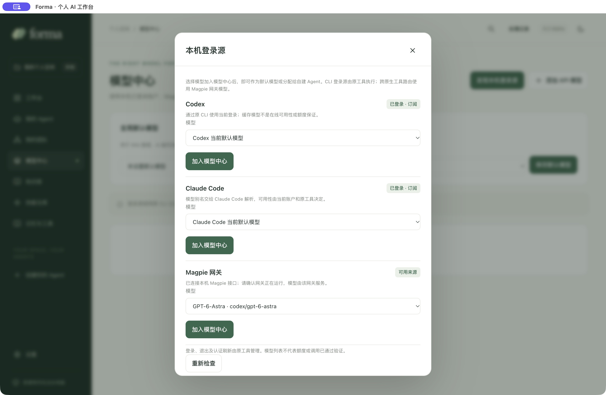
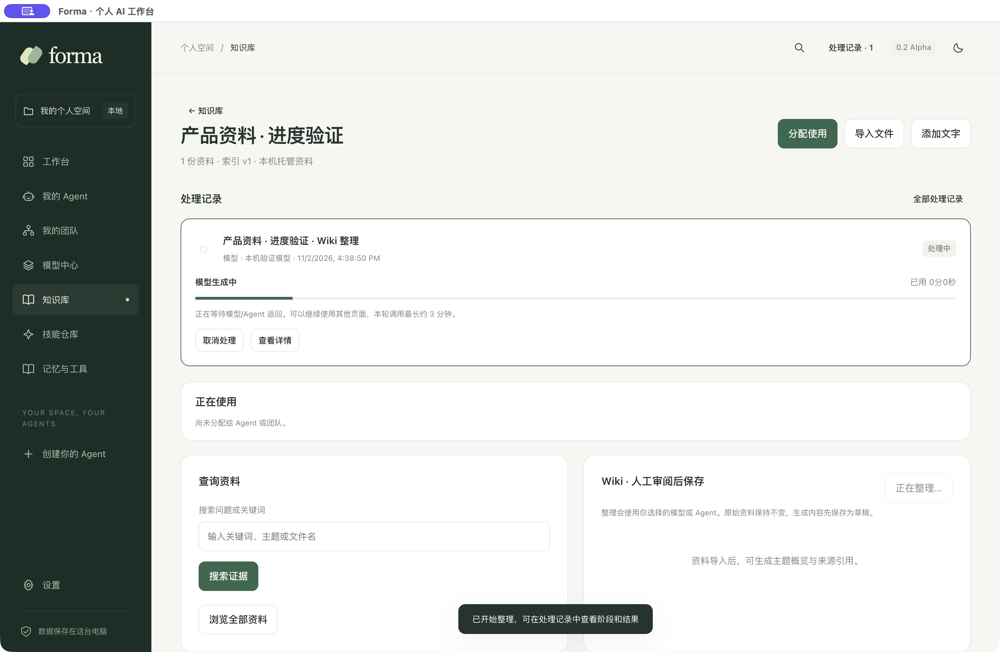
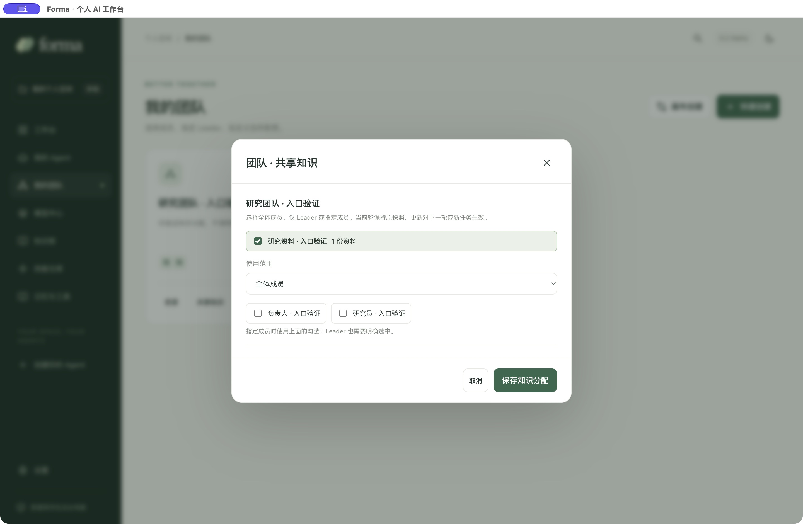
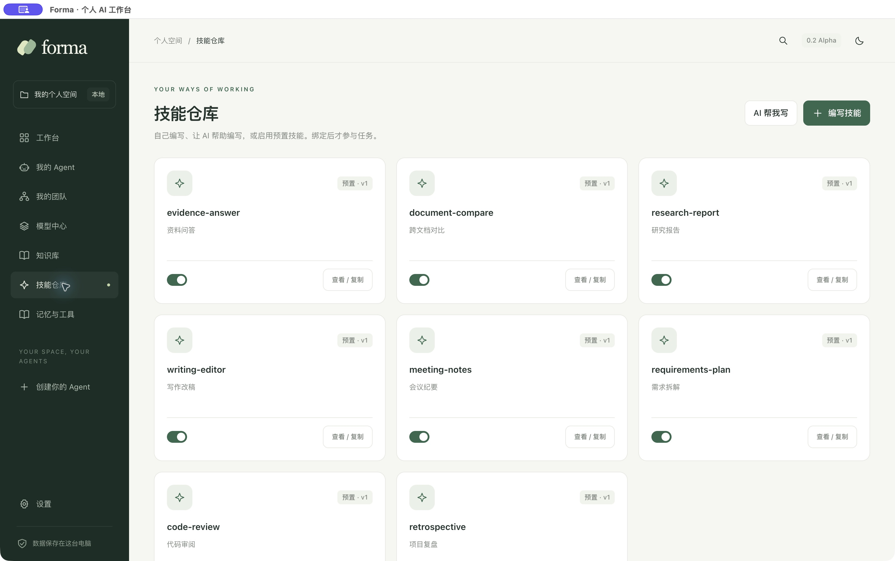

<div align="center">
  
  <h1>Forma</h1>
  <p><strong>Your agents. Your team. One workspace that keeps going.</strong></p>
  <p>An open-source personal AI desktop workspace for models, knowledge and reusable skills.</p>

[](https://github.com/wpfbcr/forma/actions/workflows/check.yml)
[](https://github.com/wpfbcr/forma/releases)
[](LICENSE)

[简体中文](README.md) · **English**

[Overview](#overview) · [Quick start](#quick-start) · [Product tour](#product-tour) · [Features](#features) · [Documentation](#documentation) · [Contributing](#contributing)
</div>

## Overview

Forma brings agents you create, installed tools such as Codex and Claude Code, knowledge libraries and skills into one desktop workspace. Define your team, then keep talking to its Team Leader. The Leader plans, delegates and reviews work while the task keeps its materials, context, execution records and versioned deliverables on disk.

It is designed for individual users working across coding, research, writing and everyday tasks. New installations start with an empty personal workspace: choose your own models, build your own agents and assemble your own teams.

> [!NOTE]
> **0.2.0-alpha.6** is an early preview. The UI is currently primarily Simplified Chinese. The macOS Apple Silicon desktop has been checked locally; see [Actions](https://github.com/wpfbcr/forma/actions) and the [validation log](docs/validation.md) for other platforms. Packages are unsigned and not notarized. Model access, quotas and external CLI compatibility depend on your environment.

## Quick start

### Download the desktop app

Open **[GitHub Releases](https://github.com/wpfbcr/forma/releases)** and select an asset for your operating system and architecture. Alpha versions are prereleases, so `/releases/latest` does not list them.

| Platform | Availability |
| --- | --- |
| macOS Apple Silicon | ZIP application bundle; extract and move `Forma.app` to Applications |
| Windows x64 | NSIS packaging workflow; check the assets of the individual release for an installer |
| Intel Mac / Linux | No promised installer or full desktop support yet; source builds and compatibility reports are welcome |

Check the download source and published checksum if the OS cannot verify the developer. Signing and notarization are not complete. Do not disable system-wide protections to install an Alpha.

### Run from source

Requires **Node.js 22.12+** (24 LTS recommended), npm and Git. Normal use does not require Docker, an external database or Python.

```bash
git clone https://github.com/wpfbcr/forma.git
cd forma
npm ci
npm run dev
```

The first installation downloads the pinned Electron runtime. See [installation and builds](docs/installation.md) for troubleshooting. Launch through Electron; opening `src/renderer/index.html` directly is unsupported.

### Your first task

1. In **Model Center**, discover signed-in Codex / Claude Code sources, or add an API service and fetch its model catalog using your URL and key.
2. Create an **Agent** with a role, model, memory and file tools, or connect an installed native agent.
3. Create a team, choose its **Leader**, and configure members in the canvas or quick list. A single agent can also run independently.
4. Describe a goal in the **Workbench**, select your agent or team and start. Continue with the Leader; inspect materials, context, progress and deliverables alongside the conversation.
5. Set a **global default model** for Wiki and AI skill generation. Agent execution models remain separate.

Discovery does not generate content. Connection tests and task, Wiki or skill generation use the selected account's quota. Forma does not include paid model credits.

## Product tour

These screenshots show the desktop app using isolated verification data. They do not demonstrate model quality or performance. See [screenshot provenance](docs/images/readme/README.md).

### Models and existing sign-ins

Import Codex / Claude Code sources without entering a Base URL or API key. A running local Magpie gateway can expose its own catalog.



CLI-backed sources execute through their original tools. Routing between native Codex and Claude Code requires Magpie; Forma does not embed its full account pool or subscription adapters. See [model sources](docs/model-sources.md).

### Knowledge, Wiki and background work

Import files or connect a read-only directory, assign knowledge to a team or individual agents, search originals or create a Wiki draft with a selected model or agent. Review the draft before adopting it. Persistent jobs show stages, elapsed time, errors, cancellation and manual retry.



<details>
<summary>Knowledge scope and skills</summary>

Choose all members, only the Leader or selected agents. Each round records evidence and source versions.



Write `SKILL.md`, ask AI for a draft, or enable one of eight bundled instruction skills.



</details>

## Features

| Area | Implemented capabilities |
| --- | --- |
| Agents and teams | Custom roles, native CLI integration, per-agent models, Leader, draggable canvas and quick list |
| Workbench | One Leader conversation, validated dependencies, bounded parallelism, follow-ups, queued requests, pause/stop/resume |
| Task workspace | Materials, context and round snapshots, member directories, versioned results, file preview and ZIP export |
| Models | OpenAI-compatible Chat Completions, Anthropic Messages, catalog discovery, connection tests and global default |
| Existing sign-ins | Native login checks and CLI-backed models; optional local Magpie gateway |
| Knowledge and Wiki | Directory sync, file import, keyword search, source versions, scoped access and reviewable Wiki drafts |
| Skills and memory | Editing, versions, AI drafts, eight bundled instruction skills, enable controls and manually attached preferences |
| Background jobs | Durable Wiki / skill records, stages, elapsed time, errors, cancellation, retries and interruption recovery |
| Local data | Files and JSON state, OS-backed encryption for API keys, light and dark themes |

### Current limitations

- Retrieval uses local keywords, without embeddings, reranking or OCR. Large-corpus quality is not established. Read the [benchmark and known gaps](docs/retrieval-benchmark.md).
- Wiki currently produces one topic overview draft, using the first 30 sources and up to 4,000 characters per source, rather than a full linked knowledge graph.
- Import paths have limits such as 500 files / 16 MiB indexes, but enforcement is not uniform across all entry points. These are not a reliable capacity contract.
- Skills are instructions and templates; arbitrary scripts and third-party resource bundles are not executed.
- Responses arrive as complete text with stage progress, not token streaming. Native CLI invocations use fresh sessions with Forma-provided context.
- Built-in API file tools enforce member-directory boundaries. Native CLIs use their own permissions; a working directory is not an OS sandbox.
- MCP, web-search services, scheduling, cloud sync, automatic updates and cost accounting are not available yet. See the [roadmap](docs/roadmap.md).

## Data and privacy

Configuration and materials stay on disk. API keys are encrypted separately and excluded from renderer state and workspace exports. Cloud models and signed-in cloud agents still receive the materials needed for a task: local-first does not mean offline inference. State, knowledge and ordinary files are not encrypted as a whole.

The usual data locations are `~/Library/Application Support/Forma` on macOS and `%APPDATA%/Forma` on Windows; development app names may differ. The workspace root can be changed in Settings. See the [user guide](docs/getting-started.md) and [security policy](SECURITY.md).

## Documentation

Most detailed documentation is currently in Simplified Chinese.

| Guide | Contents |
| --- | --- |
| [Documentation index](docs/README.md) | Entry points for users and contributors |
| [Installation](docs/installation.md) | Downloads, source builds and troubleshooting |
| [User guide](docs/getting-started.md) | Tasks, knowledge, skills, jobs and local data |
| [Model sources](docs/model-sources.md) | API, original CLIs and Magpie boundaries |
| [Architecture](docs/architecture.md) | Processes, state, execution and routing |
| [Validation](docs/validation.md) | Completed checks and unverified behavior |
| [Changelog](CHANGELOG.md) / [Roadmap](docs/roadmap.md) | Recent changes and planned work |

## Development

Forma uses Electron and TypeScript with an HTML / CSS / TypeScript UI. Core behavior lives in `src/core`, native integration in `src/main`, UI in `src/renderer` and shared types in `src/shared`. Tests, documentation and reproducible retrieval benchmarks have their own directories.

```bash
npm run check             # Type checks, tests and build
npm run bench:retrieval   # Synthetic retrieval benchmark
npm run pack              # Unpacked app for the current platform
npm run dist              # Installer for the current platform
```

Tests use fixed responses and do not consume model credentials or subscription quota. Actions runs Linux / macOS / Windows checks and offers manual package builds. A successful build is not a substitute for desktop validation on each platform.

## Contributing

Open an [issue](https://github.com/wpfbcr/forma/issues) with a reproducible problem or a use case, or send a pull request. Read [CONTRIBUTING.md](CONTRIBUTING.md) before making changes. Report vulnerabilities through the [private channel](SECURITY.md#报告安全问题), without posting credentials or private workspaces.

## Acknowledgments and license

[WeKnora](https://github.com/Tencent/WeKnora) informed documentation structure and knowledge-processing interactions. [Magpie](https://github.com/yetone/magpie) informed login reuse and model routing and can be connected as an optional gateway. [llm_wiki](https://github.com/nashsu/llm_wiki) informed personal knowledge-curation workflows.

Current Forma features are independently implemented; no code from those projects is copied or bundled. Dependencies and external tools retain their own terms; see [third-party notices](THIRD_PARTY_NOTICES.md).

Forma source code is released under the **[MIT License](LICENSE)**. Keep the license and copyright notice when using, modifying or redistributing it.
